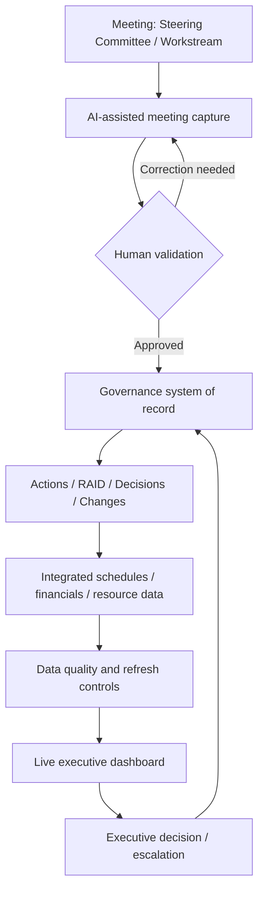
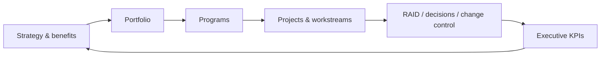
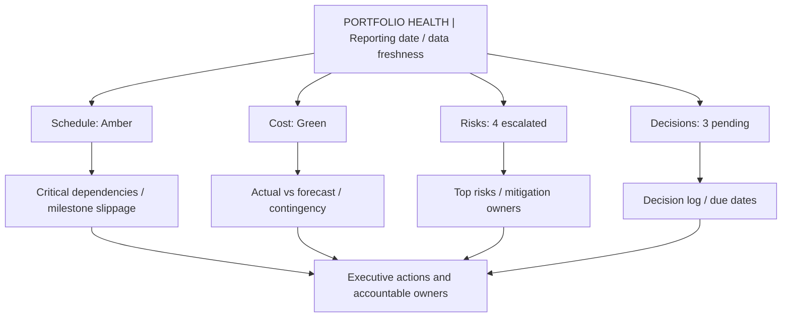

# Digital Program Management: Executive Reference and V2V Application

**Document ID:** KDOC-2026-0214  
**Date:** 2026-10-20  
**Purpose:** Consolidate the October 2026 discussion on leading digital program-management platforms, live visual dashboards, digital action-plan and governance platforms, and AI-assisted meeting capture.  
**Scope:** Conceptual reference and V2V advisory design, not a procurement recommendation or validated product-feature matrix.

## 1. Executive summary

Digital program management links **strategy, execution, governance, and benefits realization**. A project task tool tracks work; an effective program management system also governs cross-project dependencies, investment decisions, capacity, risks, approvals, and measurable outcomes.

Three complementary capabilities:
1. **Live visual dashboards** turn connected project and operational data into timely, drillable executive insight.
2. **Digital action-plan and governance platforms** maintain controlled action logs, RAID, decisions, changes, approvals, stage gates, and accountability.
3. **AI-assisted meeting capture** produces draft transcripts, summaries, decisions and action items that humans validate before they enter the official system of record.

> “Live” means as current as the underlying integrations and refresh cadence; it does not guarantee real-time accuracy. AI meeting outputs are drafts, not authoritative approvals.

## 2. Visual reference architecture

The diagrams below render as images in GitHub's Markdown viewer.

## 3. Top digital program-management platforms

| Platform | Primary strength | Best suited for | Evaluation caution |
|---|---|---|---|
| Planview | Portfolio prioritization, capacity, investment governance | Enterprise PMOs | Product/edition differences |
| Microsoft Project / Planner | Scheduling, dependencies, Microsoft 365 ecosystem | Microsoft-centric complex delivery | Scheduling depth differs by plan |
| Adobe Workfront | Intake, workflows, approvals, resource visibility | Marketing and digital operations | Portfolio needs vary by implementation |
| ServiceNow Strategic Portfolio Management | Demand, investment, governance, IT workflow integration | Enterprise IT transformation | Configuration and licensing complexity |
| Jira + Jira Align | Agile team execution and strategy-to-execution alignment | Product/software organizations | Cross-tool integration required |
| Smartsheet | Flexible plans, automation, reporting | Cross-functional programs | Governance must be deliberately designed |
| monday.com | Visual tracking and workflow automation | Mid-market PMOs | Assess financial/dependency depth |
| Wrike | Workflow, approvals, resource coordination | Cross-functional delivery | Verify edition-specific features |
| Asana | Goals, portfolios, collaboration | Business transformation | Assess enterprise controls |
| Celoxis | Portfolio, resource and financial planning | Cost-conscious PMOs | Validate integration fit |
| Clarity PPM | Investment, capacity, financial governance | Large enterprise PMOs | Implementation effort |
| Oracle Primavera P6 | Critical path, capital project controls | Engineering/construction | Less suited to lightweight digital teams |

**Enterprise shortlist discussed:** Planview, Microsoft Project/Planner, ServiceNow SPM, Adobe Workfront, Jira Align. This is a qualitative shortlist, not a verified market-share ranking.

### Core platform assessment dimensions

| Dimension | Example evidence |
|---|---|
| Strategic alignment / benefits | Outcome register, benefits owner, benefit KPIs |
| Schedule / dependencies | Integrated master schedule, critical path, dependency map |
| RAID / decision management | Traceable issue/risk/decision lifecycle |
| Resource / capacity | Demand versus supply by skill and time |
| Financial management | Baselines, actuals, forecast, EVM where appropriate |
| Executive reporting | Portfolio rollups, drill-downs, exception thresholds |
| Automation / integration | APIs, workflows, audit logs, data provenance |
| AI analytics | Forecast explanations, anomaly detection with review controls |

## 4. Live visual dashboards

**Definition:** An interactive, frequently refreshed view of program health based on schedules, work systems, finance, resource plans, and operational data.

**Common measures:** schedule, cost, scope, quality, risk; milestones; cross-project dependencies; capacity/utilization; budget/actual/forecast; earned value (where suitable); exceptions and decisions pending.

**Examples of tools:** Power BI, Planview, Tableau, Smartsheet, ServiceNow SPM.

**Scenario:** Three projects move from green to amber because a shared infrastructure milestone slips. The portfolio dashboard shows impacted workstreams and potential downstream milestones; an executive can drill down to the dependency owner.

### Illustrative dashboard wireframe (not real performance data)

**Controls:** publish data lineage, source timestamps, metric definitions, tolerance thresholds, owner sign-off, access controls, and exception handling. Never equate attractive charts with reliable status integrity.

## 5. Digital action-plan and governance platforms

**Definition:** A controlled, centralized workflow for commitments, decisions, approvals, escalation and stage-gate governance—not merely a task list.

| Governance artifact | Minimum digital fields |
|---|---|
| Action log | ID, description, accountable owner, due date, status, evidence |
| RAID register | Type, impact, probability (risk), owner, response, escalation |
| Decision log | Decision ID, options, authority, rationale, date, approver |
| Change request | Baseline, impact, cost/schedule/scope effects, approval |
| Stage gate | Entry/exit criteria, evidence, approval, exceptions |
| Escalation register | Trigger, threshold, routed authority, resolution |
| Benefits register | Benefit, baseline, target, owner, measurement date |

**Tools discussed:** ServiceNow SPM, Adobe Workfront, Smartsheet, monday.com, Microsoft Power Platform.

**Scenario:** A change request exceeds budget tolerance; workflow routes it to the designated authority or Change Control Board, retains impact analysis and approval history, and updates the official baseline only after approval.

**PMI alignment:** integrated change control, stakeholder engagement, risk management, governance, program benefits, and portfolio strategic alignment. Specific PMI edition/page references are intentionally omitted because no edition was established in the discussion.

## 6. AI-assisted meeting capture

**Definition:** Speech recognition and generative AI produce searchable transcripts, meeting summaries, draft decisions, unresolved questions, and candidate action items.

**Tools discussed:** Microsoft 365 Copilot/Teams, Fireflies.ai, Otter.ai, Fathom, Zoom AI Companion.

**Workflow:** Obtain recording consent and verify policy → capture meeting → generate transcript and draft summary → human reviews speaker attribution, decision authority, owners and deadlines → approve official minutes/actions → synchronize to governance records → monitor follow-up.

**Scenario:** Steering committee discussion proposes $150,000 additional funding. AI drafts the decision record; an authorized person verifies that approval was actually granted and confirms the responsible owner **before** a budget baseline is changed.

**Risks:** inaccurate transcription, fabricated commitments, confusion between discussion and authorization, sensitive information exposure, retention/compliance, access permissions, and integration failures.

## 7. Integrated operating model and RACI sketch

| Activity | AI capture | PMO / program lead | Decision authority | System |
|---|---|---|---|---|
| Transcribe discussion | Draft | Review | — | Store under retention policy |
| Extract action/decision candidates | Draft | Validate | Confirm when necessary | Stage pending |
| Approve change / funding | No authority | Prepare recommendation | Approve / reject | Audit decision |
| Maintain RAID/actions | Suggest updates | Accountable for quality | Escalation as needed | Version and audit |
| Publish executive dashboard | Summarize anomalies | Certify status integrity | Act on exceptions | Refresh / provenance |

## 8. V2V Digital Program Governance Accelerator (concept)

**Proposed value proposition:** A repeatable, executive-oriented advisory accelerator to diagnose delivery health, strengthen governance, surface dependencies, and translate data into timely decisions and benefits.

**Low-cost reference stack:** Microsoft Lists + Power Automate for governance, Power BI for dashboards, Teams + Copilot or Fathom for meeting capture, PowerPoint for executive communication. This is a conceptual stack; licensing, security, and connector availability require validation.

**Potential client deliverables:**
- Program governance charter and decision-rights matrix
- Integrated action/RAID/decision/change registers
- Data dictionary and KPI threshold catalog
- Portfolio/program executive scorecard
- Meeting capture, validation and approval SOP
- Escalation workflow and stage-gate evidence checklist
- 30/60/90-day recovery roadmap and benefits measurement plan

**MVP sequence:** 1) select pilot program and outcomes; 2) baseline KPI definitions; 3) establish authoritative governance records; 4) integrate source data; 5) prototype dashboard; 6) pilot AI capture with human review; 7) test access/audit/quality controls; 8) executive demonstration and improvement backlog.

## 9. Practical selection guidance

- **Enterprise career / PMO leadership:** prioritize fluency with Planview, ServiceNow SPM, Microsoft Project/Planner, Workfront, and Jira Align.
- **V2V delivery economics:** use a lightweight governance/data stack first, then adapt to each client's existing enterprise tools.
- **Evaluation principle:** the differentiator is governance design, delivery recovery methodology, executive insight and measurable value—not the software brand.

## 10. Decision, risk and action log

| Type | Item | Status |
|---|---|---|
| Concept | Three capabilities should form one governed operating model | Proposed |
| Concept | V2V Digital Program Governance Accelerator | Proposed; not implemented |
| Decision | Vendor/platform purchase or subscription | Not decided |
| Risk | Dashboard metrics become stale or inconsistent | Mitigate with freshness and lineage controls |
| Risk | AI-generated decisions mistaken for approvals | Require human authorization |
| Risk | Confidential meeting data mishandled | Assess consent, retention and access |
| Next action | Compare platform capabilities, pricing and licensing | Open |
| Next action | Build illustrative V2V governance templates | Open |
| Next action | Prototype executive dashboard with mock data | Open |
| Next action | Validate PMI standard/edition for page-level mapping | Open |

## 11. Source and currency notes

This reference consolidates **the discussion in this ChatGPT conversation**; platform descriptions are high-level summaries, not independently verified current vendor claims. Diagrams are original conceptual illustrations rendered with Mermaid. Product names belong to their respective owners. Validate current plans, pricing, capabilities, API availability, data protection terms, and procurement requirements directly with vendors before implementation.
