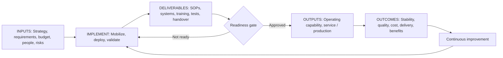
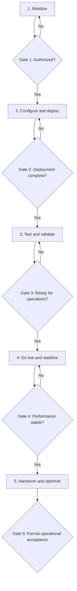

# Operations Management — Implementation Inputs, Deliverables, Outputs and Readiness Gates

**K-DOC:** KDOC-2026-0215  
**Version:** 1.0 | **Date:** 2026-10-20  
**Source scope:** This document archives the discussion of the standard inputs, deliverables and outputs for the **Implementation** stage in Operations Management. The framework is a cross-disciplinary synthesis, **not** a single universal normative standard.

## 1. Executive summary

Implementation translates an approved operating strategy, process design, or improvement initiative into an operational capability that reliably delivers intended results.

- **Inputs:** Approved plans, requirements, resources, funding, controls and targets required to start.
- **Deliverables:** Tangible implementation work products: processes, configured systems, trained staff, validation evidence and handover records.
- **Outputs and outcomes:** Functioning operational capability, readiness, stable performance, quality, service reliability and realized benefits.

**Critical distinction:** Completing implementation tasks is not the same as demonstrating operational readiness; readiness is not the same as sustained benefits realization.

## 2. Visual operating model

## 3. Standard inputs

| Input | Purpose |
|---|---|
| Business case and objectives | Establish intended value and success criteria |
| Approved operating strategy | Define how operations should work |
| Process design and requirements | Specify workflows, capacity, quality and controls |
| Implementation plan | Define milestones, dependencies and responsibilities |
| Resource and capacity plan | Confirm personnel, equipment, facilities and materials |
| Approved budget | Fund deployment and startup |
| Technology and infrastructure requirements | Define systems, integration and equipment |
| Procurement and supplier agreements | Secure third-party resources |
| Risk assessment | Identify implementation and operating risks |
| Change management and communications plan | Prepare affected stakeholders |
| Performance baseline and KPI targets | Define measurable acceptance |
| Regulatory and compliance requirements | Establish required safeguards |

**Entry control:** Scope, resources, accountability and measurable acceptance criteria should be approved before implementation.

## 4. Standard implementation deliverables

| ID | Deliverable | Typical artifact or evidence |
|---|---|---|
| IMP-D01 | Operational processes | Process maps, SOPs, work instructions |
| IMP-D02 | Configured systems and infrastructure | Installed equipment, configured software, facilities |
| IMP-D03 | Workforce readiness | Training records, competency assessments |
| IMP-D04 | Resource deployment | Staffing rosters, allocation records |
| IMP-D05 | Supplier readiness | Approved suppliers, service agreements |
| IMP-D06 | Quality controls | Inspection plans, checkpoints |
| IMP-D07 | Risk and safety controls | Risk register, safety procedures, contingency plans |
| IMP-D08 | Performance monitoring | KPI dashboard, data collection procedures |
| IMP-D09 | Testing and validation | Pilot results, acceptance tests, defect log |
| IMP-D10 | Transition and handover | Operations manual, support model, ownership transfer |
| IMP-D11 | Governance records | Status, RAID, decisions, approvals |
| IMP-D12 | Operational readiness assessment | Checklist and go/no-go recommendation |

**Deliverable versus outcome:** A completed training record is a deliverable; demonstrated, sustained operator competence is an outcome.

## 5. Outputs and operational outcomes

| Output / outcome | Measurement or evidence |
|---|---|
| Operational capability | Process or service functions |
| Production/service readiness | Formal acceptance |
| Workforce competency | Demonstrated proficiency |
| Process stability | Consistent cycle times, controlled variation |
| Throughput/capacity | Units or services per time period |
| Quality conformance | Defects, yield, first-pass quality |
| Cost performance | Unit cost, operating expense, variance |
| Delivery reliability | On-time delivery, service levels |
| Safety/compliance | Audit findings, incidents, conformance |
| Customer satisfaction | Feedback, service-quality measures |
| Benefits realization | Actual versus expected savings/value |
| Improvement baseline | Validated KPIs and backlog |

Sustained outcomes often require a post-launch stabilization period and should not be claimed at initial go-live.

## 6. Implementation lifecycle and stage gates

| Phase | Activities | Gate |
|---|---|---|
| Mobilize | Confirm scope, resources, funding, governance | G1: Authorization to implement |
| Configure and deploy | Establish systems, workflows, staffing and suppliers | G2: Deployment complete |
| Test and validate | Pilot, capacity and quality tests, corrective actions | G3: Operational readiness approval |
| Go live and stabilize | Deliver service/production, monitor and correct | G4: Stable operational performance |
| Handover and optimize | Transfer ownership, ongoing controls, benefits tracking | G5: Formal operational acceptance |

**Governance note:** Gate ordering and labels are an illustrative control model from the discussion; organizations may place formal acceptance at an earlier or different transition point.

## 7. Framework alignment

| Framework | Relevant implementation emphasis |
|---|---|
| PMI / PMBOK | Delivery, stakeholders, risk, acceptance and transition |
| Lean Six Sigma DMAIC | Implement changes in Improve; sustain controls in Control |
| ISO 9001 | Controlled operations, competence, documentation, monitoring, correction |
| ITIL 4 | Change enablement, release, deployment and service validation |
| APQC Process Classification Framework | Standardized business processes and performance management |
| ADKAR | Awareness, Desire, Knowledge, Ability, Reinforcement |

These are conceptual alignments rather than claims that all frameworks prescribe this exact list. Specific edition/page mappings were not established.

## 8. Chemical manufacturing implementation example

| Category | Example |
|---|---|
| Inputs | Approved process design, PFDs/P&IDs, equipment specifications, safety assessment, budget and capacity needs |
| Deliverables | Installed equipment, SOPs, operator training, commissioning records, validated quality controls |
| Immediate outputs | Commissioned line, qualified operators, authorized startup, initial production |
| Sustained outcomes | Target throughput, yield, stable quality, safe operations and reduced unit cost |

## 9. Implementation control register (illustrative)

| ID | Deliverable | Accountable role | Acceptance criterion | Evidence | Status |
|---|---|---|---|---|---|
| IMP-01 | SOPs approved | Operations Lead | Critical SOPs approved | SOP repository | Pending |
| IMP-02 | Staff trained | Training Lead | Competency demonstrated | Training records | Pending |
| IMP-03 | Systems validated | Technical Lead | Critical tests passed | Test report | Pending |
| IMP-04 | Operational readiness | Operations Manager | Critical readiness criteria met | ORR checklist | Pending |
| IMP-05 | Handover accepted | Business Owner | Acceptance recorded | Handover sign-off | Pending |

These are sample roles and statuses, not actual project assignments.

## 10. Decisions, risks and next actions

| Type | Item | State |
|---|---|---|
| Recommendation | Separate implementation completion, readiness and benefits realization into distinct controls | Proposed |
| Risk | Premature success declaration after task completion | Mitigate through gate criteria |
| Risk | Training completion mistaken for competence | Validate performance |
| Risk | Go-live before safety/quality readiness | Require formal go/no-go |
| Next action | Define an end-to-end OM lifecycle: Strategy → Design → Plan → Implement → Operate → Monitor & Control → Improve | Proposed |
| Next action | Map inputs, deliverables, outputs and stage gates for every lifecycle phase | Proposed |
| Next action | Select applicable standards and editions for clause/page-level mapping | Open |

## 11. Provenance and revision history

**Source:** User question and assistant's explanatory answer in this ChatGPT conversation on 2026-10-20. This document consolidates that discussion without independent standards verification. Mermaid diagrams are original conceptual representations of the discussion.

| Version | Date | Change |
|---|---|---|
| 1.0 | 2026-10-20 | Initial archival reference, implementation tables, readiness gates, diagrams and controls |
