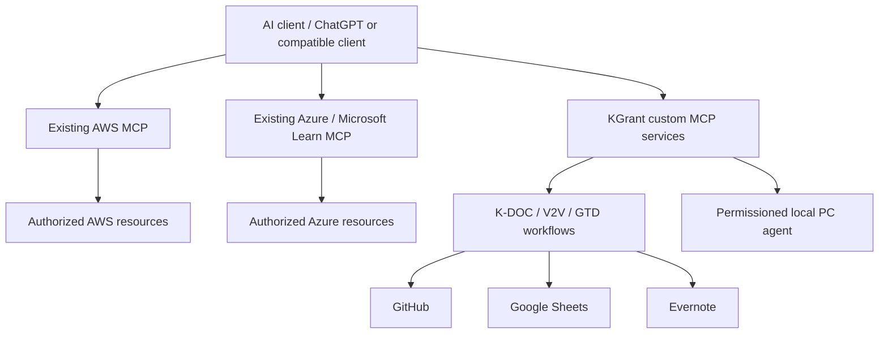
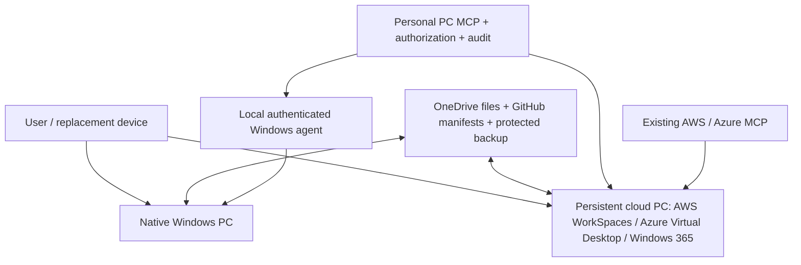
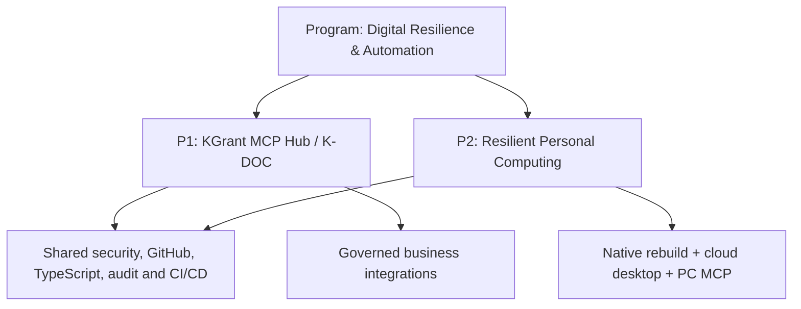

# Custom MCP and Resilient Personal Computing
## Architecture, Two Project Plans, Cloud Options, Cost and Integrated Roadmap

**K-DOC:** KDOC-2026-0216  
**Version:** 1.0 | **Date:** 2026-10-20  
**Status:** Planning proposal; not approved or implemented.

> **Source integrity:** This archives the recent discussion and its proposed figures. Vendor prices, product capabilities, ChatGPT MCP connection entitlements, SDK versions and provider terms were not independently revalidated during this archival step. Treat all cost figures as planning estimates, not quotes or confirmed current pricing. No cloud infrastructure, GitHub project repository or MCP server has been provisioned as part of this discussion.

## 1. Executive summary

Two complementary projects were developed:

1. **Project 1 — KGrant MCP Hub:** A custom Model Context Protocol integration platform, piloting K-DOC publishing, registration and verification across GitHub, Google Sheets and Evernote.
2. **Project 2 — KGrant Resilient Personal Computing Platform:** A persistent cloud desktop (AWS WorkSpaces, Azure Virtual Desktop or Windows 365), automated native Windows rebuilding (WinGet/PowerShell/DSC), OneDrive-based file synchronization, separate backups, and a permissioned personal-computer MCP.

**User's principal resilience objective:** If primary PC hardware fails, access the same persistent cloud desktop from replacement hardware; alternatively rebuild a native Windows PC automatically with applications/settings and resume OneDrive-backed work. A custom MCP should provide substantially more PC operations capability than AWS resource-management MCP alone.

**Architectural clarification:** Cloud and local desktops are separate OS installations. OneDrive sync is not a complete OS/app/settings backup; cloud resource MCP does not automatically control a physical Windows endpoint.

## 2. MCP fundamentals and existing cloud MCPs

MCP enables an AI client to use exposed **tools** (actions), **resources** (data/context) and **prompts** (reusable workflows). A custom MCP server is not a model and requires a compatible client, access control, authentication and approved integrations.

Existing offerings discussed:
- **AWS:** AWS-managed MCP offering, AWS Knowledge MCP and specialized AWS Labs MCP servers (including cloud-service and infrastructure tools).
- **Azure:** Microsoft Azure MCP Server and Microsoft Learn MCP Server.
- Use existing cloud MCPs for authorized cloud operations and documentation rather than rebuilding them.
- **Custom MCP** is justified for unique K-DOC governance and local Windows/PC administration workflows.
- Client availability and read/write permission levels vary by plan, deployment and product; verify before design commitment.

### 2.1 Logical MCP topology



The AI client may connect to multiple servers directly; a universal proxy hub is not mandatory.

## 3. Project 1 — KGrant MCP Hub

**Purpose:** Standardize and automate knowledge-management and professional workflows, starting with K-DOC.

### 3.1 Potential modules

| Module | Intended use | Priority |
|---|---|---|
| K-DOC | Search, prepare, publish, register and verify documents | MVP |
| K-GTD | Capture, review and track next actions | Phase 2 |
| V2V PMO | RAID, status, executive dashboards, recovery governance | Phase 2 |
| K-Career | Job fit, application research and tracking | Phase 3 |
| K-BIBA | Structured Bible research and archives | Phase 3 |
| K-Finance | Budget and controlled financial operations | Later; higher-security |

### 3.2 Proposed K-DOC MVP tools

| Tool | Behavior |
|---|---|
| `kdoc_search` | Search indexed records and metadata |
| `kdoc_prepare_document` | Validate Markdown, metadata and registration readiness |
| `kdoc_register_document` | After approval, publish and register across systems |
| `kdoc_verify_registration` | Read back and reconcile GitHub, Google Sheets and Evernote |

**Workflow:** Selected discussion content → document preparation → human approval → GitHub → registry → Evernote → verification. The MCP does not inherently have access to all prior ChatGPT conversation history; selected content must be supplied by an authorized client/workflow.

### 3.3 Proposed architecture

- TypeScript + official MCP SDK; remote Streamable HTTP transport.
- Cloudflare Workers as hosting candidate; GitHub for source and CI/CD.
- Separate adapters for GitHub, Google Sheets and Evernote.
- Secrets storage, least-privilege access, validation, audit trails, approval gates, retries, reconciliation and idempotency.
- Begin with read-only/dry-run operations; permit writes only after explicit approval and successful authorization.
- Verify API availability, especially Evernote and client-specific MCP write access, during discovery.

### 3.4 WBS, schedule and cost

| WBS | Work package | Deliverables | Effort |
|---|---|---|---|
| 1.0 | Discovery and architecture | Charter, requirements, API feasibility, decisions | 6–10 h |
| 2.0 | MCP foundation | Repo, server, tests, deployment pipeline | 8–12 h |
| 3.0 | GitHub integration | Publishing, duplicates, commit verification | 7–12 h |
| 4.0 | K-DOC integration | Sheets/Evernote records, ID checks, reconciliation | 9–16 h |
| 5.0 | Security and quality | Authentication, approvals, tests and recovery | 7–12 h |
| 6.0 | Pilot and handover | Five scenario acceptance tests, runbook, backlog | 3–8 h |
| | **Total** | | **40–70 h** |

**Baseline:** 4–6 weeks at 8–12 hours/week; **$0–$100 initial cash**, excluding labor, with indicative ongoing **$0–$30/month**. At an illustrative $75/hour, opportunity cost **$3,000–$5,250**.

**Six-week milestone sequence:** W1 architecture approved → W2 MCP test tool operational → W3 GitHub publishing → W4 K-DOC registration → W5 security/recovery tested → W6 MVP accepted. Proposed baseline start was October 26, 2026; no calendar schedule was actually created.

## 4. Project 2 — Resilient Personal Computing Platform

### 4.1 Business and technical requirements

- Persistent cloud-hosted Windows desktop accessible from replacement hardware.
- Native Windows environment rebuilt using approved scripts and package manifests.
- OneDrive file synchronization across cloud and native PCs, with a separate backup/recovery strategy.
- Restore applications, settings and supported application data with minimum manual effort.
- Permissioned MCP for PC inventory, diagnostics, controlled configuration and recovery.
- Account security, MFA, credential recovery, licensing, monitoring and tested continuity.
- Preserve offline native-PC capability when cloud or Internet is unavailable.

### 4.2 Proposed architecture



**Important:** Cloud MCP can manage authorized cloud resources, but an endpoint agent or other secure local management channel is required for deep physical-PC operations. Local/cloud installed applications and registry state do not automatically synchronize.

### 4.3 Candidate cloud desktops

| Candidate | Strength | Trade-off |
|---|---|---|
| Windows 365 Business | Simplest managed persistent cloud-PC experience; Microsoft ecosystem | Subscription and reduced infrastructure control |
| AWS WorkSpaces Personal | AWS-oriented learning and API automation; persistent desktop | Identity, configuration, licensing and usage management |
| Azure Virtual Desktop | Enterprise customization and deep Azure control | More complex infrastructure and license requirements |

**Evaluation order proposed:** Windows 365 Business (ease baseline), AWS WorkSpaces Personal (AWS automation fit), Azure Virtual Desktop (custom enterprise architecture). Choice remains open, including whether cloud PC is daily primary or emergency fallback.

### 4.4 Native Windows automation

Proposed repository `kgrant-pc-platform` (not created):

```text
kgrant-pc-platform/
  README.md
  manifests/
    applications.json
    windows-config.dsc.yaml
  scripts/
    bootstrap.ps1
    install-apps.ps1
    restore-settings.ps1
    configure-onedrive.ps1
    validate-build.ps1
  profiles/
    personal/
    v2v/
  mcp/
    server/
    tools/
  infrastructure/
    aws/
    azure/
  docs/
    recovery-runbook.md
    architecture.md
    test-results.md
```

Recovery sequence: provision replacement Windows PC → authenticate to GitHub → retrieve/review trusted bootstrap → install apps with WinGet → apply supported settings using PowerShell/DSC → sign in to OneDrive → restore app-specific data from separate backups → validate OS/apps/accounts/security. Scripts should be **idempotent**, logged and safe to rerun. Device drivers, MFA, licensing and some app settings may require manual steps.

### 4.5 Personal Computer MCP tool catalogue

| Tool | Capability | Control |
|---|---|---|
| `pc_inventory` | Apps, OS, hardware and storage | Read |
| `pc_health_check` | Disk, updates, services and utilization | Read |
| `pc_compare_baseline` | Drift from desired configuration | Read |
| `pc_list_files` | Browse approved folders | Read |
| `pc_search_files` | Search approved file areas | Read |
| `pc_backup_status` | Sync and backup health | Read |
| `pc_install_approved_app` | Install allowlisted apps | Approval |
| `pc_apply_configuration` | Apply approved settings | Approval |
| `pc_run_recovery` | Execute approved restoration | Approval |
| `pc_execute_command` | Restricted diagnostics only | Approval |

**Security constraints:** No default unrestricted PowerShell, arbitrary deletion, credential extraction or standing admin access. Require least privilege, allowlists, explicit confirmation for high-impact actions, audit logs, timeouts, safe retries and revocation.

### 4.6 Resilience scenarios and proposed objectives

| Failure | Recovery design |
|---|---|
| Physical PC failure | Connect to persistent cloud desktop |
| Windows corruption | Reinstall OS and run bootstrap |
| Cloud PC failure | Restore supported provider backup or reprovision |
| Accidental OneDrive deletion | Version history or independent backup |
| Configuration loss | Reapply manifests and restore application data |
| Provider outage | Native Windows with offline-available files |
| Internet outage | Locally installed applications and cached files |
| Account compromise | Revoke sessions, rotate credentials, restore trusted backup |

**Proposed targets, not guarantees:** Cloud fallback RTO 30–60 minutes; native recovery RTO 2–4 hours after Windows setup; synced-file RPO 15 minutes after successful synchronization; app configuration RPO 24 hours; weekly backup verification; quarterly full recovery simulation. Actual capabilities depend on licensing, provider backup, synchronization and network conditions.

### 4.7 Project 2 WBS, schedule and cost

| WBS | Work package | Deliverables | Effort |
|---|---|---|---|
| 1.0 | Inventory and requirements | Software inventory, RTO/RPO, workloads | 8–12 h |
| 2.0 | Cloud platform selection | Options/cost model, architecture decision | 6–10 h |
| 3.0 | Data and identity | OneDrive, backup, MFA and recovery | 8–14 h |
| 4.0 | Native PC automation | WinGet, PowerShell/DSC, restore scripts | 14–24 h |
| 5.0 | Cloud PC deployment | Provisioning, apps, remote access and sync tests | 10–18 h |
| 6.0 | Personal PC MCP | Inventory, diagnostics, approved operations | 12–24 h |
| 7.0 | Resilience validation | Failure simulation, restore runbook | 7–13 h |
| | **Total** | | **65–115 h** |

**Baseline:** 6–10 weeks; **$100–$350 initial cash**; **$35–$120/month target** ongoing. The discussion used illustrative monthly allowances of Windows 365 $28–$66, AWS WorkSpaces $35–$110, Azure VDI $45–$150; these are **not like-for-like verified quotes**. A modest 8-GB desktop was suggested as a starting point subject to workload validation.

**10-week outline:** W1–2 inventory; W2–3 cloud decision; W3–4 data/identity; W4–6 native automation; W5–6 cloud deployment; W7–9 PC MCP; W9–10 recovery simulation.

## 5. Side-by-side project comparison

| Dimension | P1 — KGrant MCP Hub | P2 — Resilient PC |
|---|---|---|
| Goal | Automate business/knowledge workflows | Reduce dependence on one physical PC |
| Primary outcome | Working K-DOC MCP | Cloud fallback and reproducible native Windows |
| Main stack | MCP, TypeScript, APIs, GitHub, Cloudflare | Cloud PC, OneDrive, WinGet, PowerShell, MCP |
| Duration | 4–6 weeks | 6–10 weeks |
| Effort | 40–70 h | 65–115 h |
| Initial cash | $0–$100 | $100–$350 |
| Recurring cash | $0–$30/month | $35–$120/month target |
| Main dependency | Client and API write permissions | Desktop licensing, backup and endpoint control |
| Commercial potential | V2V governance automation | Cloud resilience and endpoint operations |

## 6. Integrated program recommendation

**Program:** KGrant Digital Resilience & Automation Program.



Proposed integrated sequence:
1. Weeks 1–2: PC/application/data inventory.
2. Weeks 3–5: Native Windows recovery automation and backup validation.
3. Weeks 5–7: Cloud desktop pilot.
4. Weeks 7–10: Personal PC MCP.
5. Weeks 10–13: K-DOC MCP.
6. Weeks 13–15: Integrated acceptance and runbooks.

**Combined planning baseline:** 12–15 weeks, **105–185 hours**, **$100–$450 initial cash**, **$35–$150/month ongoing** (before any re-estimate, taxes, new licenses or significant usage). Shared component reuse may reduce effort; this is not an approved project budget.

**Priority recommended in discussion:** Start P2 with the native-PC automation subset for immediate resilience, then test cloud desktop, then implement Personal PC MCP and K-DOC MCP.

## 7. Key risks, controls and open decisions

| ID | Type | Item | Proposed response |
|---|---|---|---|
| R-01 | Risk | MCP client lacks required custom/write support | Validate supported client and permissions in discovery |
| R-02 | Risk | External APIs restrict K-DOC automation | API proof of concept before full implementation |
| R-03 | Risk | Duplicate K-DOC registration | Unique IDs, idempotency and readback |
| R-04 | Risk | Partial writes across GitHub/Sheets/Evernote | Reconciliation and retry state |
| R-05 | Risk | Endpoint MCP overprivilege | Explicit approvals, least privilege, local agent |
| R-06 | Risk | OneDrive sync mistaken for backup | Independent backup and restore test |
| R-07 | Risk | Cloud desktop cost/licensing higher than estimate | Provider quote and monthly spend cap |
| R-08 | Risk | Cloud and native environments drift | Desired-state manifests and periodic comparison |
| D-01 | Decision open | Primary daily cloud PC or emergency fallback? | Decide before provider/billing selection |
| D-02 | Decision open | AWS WorkSpaces, Windows 365 or Azure Virtual Desktop? | Score ease, cost, performance and integration |
| D-03 | Decision open | K-DOC standalone pilot vs integrated hub deployment | Keep modular design |
| D-04 | Decision open | Permitted local PC MCP write operations | Establish threat model and approvals |
| D-05 | Decision open | Recovery targets and backup retention | Validate with realistic failure tests |

## 8. Next actions and acceptance criteria

1. Inventory installed software, profiles, license dependencies, data locations and existing OneDrive settings.
2. Confirm desired cloud-PC usage pattern (primary vs standby), Windows version, RAM/storage and performance requirements.
3. Verify AWS/Azure/Windows 365 regional licensing and pricing for the actual configuration.
4. Create a feasibility matrix for existing AWS/Azure MCP servers and custom endpoint MCP.
5. Prove local WinGet/PowerShell bootstrap on a test Windows environment.
6. Design secure local agent, command allowlists, authorization and audit logging.
7. Pilot a persistent cloud desktop and run hardware-loss fallback test.
8. Test independent backup restoration, not just file synchronization.
9. Implement K-DOC MCP using existing governance standards and test duplicate-safe registration.
10. Approve baseline charter, RAID, cost cap, milestones and operational runbooks.

**Proposed acceptance:** From replacement hardware, access persistent cloud desktop; from fresh Windows, restore a usable native environment using approved scripts; demonstrate files and app-specific data restoration; verify permissioned MCP diagnostics and approved operations; confirm K-DOC registration is consistent across systems.

## 9. References, caveats and revision history

Discussion referenced the following vendor/project resources for future verification:
- AWS MCP examples: https://github.com/awslabs/mcp
- AWS Knowledge MCP: https://knowledge-mcp.global.api.aws
- Microsoft Azure MCP documentation: https://learn.microsoft.com/en-us/azure/developer/azure-mcp-server
- Microsoft MCP repository: https://github.com/microsoft/mcp
- Microsoft Learn MCP: https://github.com/MicrosoftDocs/mcp
- AWS WorkSpaces: https://aws.amazon.com/workspaces/
- Azure Virtual Desktop: https://azure.microsoft.com/en-us/products/virtual-desktop/
- Windows 365: https://www.microsoft.com/en-us/windows-365
- WinGet: https://learn.microsoft.com/en-us/windows/package-manager/winget/

**Limitations:** All architectures, tools, dates, RTO/RPO and cost figures are discussion-derived proposals. This archive does not assert deployment, subscription, API entitlement, vendor certification or performance verification.

| Version | Date | Change |
|---|---|---|
| 1.0 | 2026-10-20 | Initial integrated archive of custom MCP discussion, AWS/Azure MCP options, two project plans and comparative roadmap |
