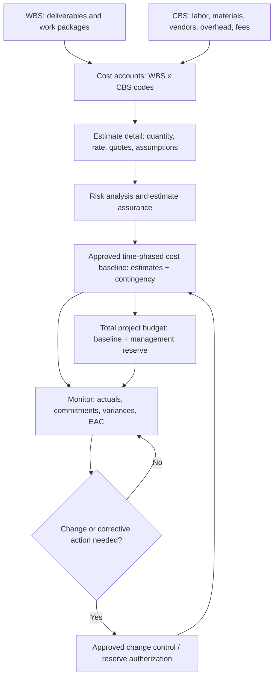

# Cost Breakdown Structure (CBS): Classification, Governance and Financial Control

**K-DOC:** KDOC-2026-0220 | **Version:** 1.0 | **Date:** 2026-10-20 | **Status:** Working paper, review open | **Category:** Professional / Program Management

## Executive summary
A Cost Breakdown Structure (CBS) classifies *types of cost*, whereas a Work Breakdown Structure (WBS) organizes *deliverable scope*. The two should be cross-referenced through cost accounts, with documented estimates, baseline approval, risk treatment, and ongoing forecasting. Contingency and management reserve should not be mistaken for ordinary cost types.

## Infographic 1: CBS hierarchy (user-provided Template22/Tariq Noor image)
The first image shows a three-level hierarchy under total project cost:
1. **Direct costs:** materials (steel, concrete, electrical, mechanical, other), labor, equipment, subcontractors, site expenses.
2. **Indirect costs:** project office, utilities, support staff, communications, other overhead.
3. **Contingency:** design, construction, procurement, other contingencies.
4. **Management reserve:** internal and executive/strategic reserve.
5. **Taxes and fees:** taxes, permits/licenses, insurance, other fees.

Its accompanying explanations describe hierarchical decomposition, estimation, budgeting, monitoring, cost-element completeness, transparency and risk coverage. **Important correction:** contingency and management reserve are reserve treatments, not simply equivalent siblings to labor and materials. Taxes, fees and insurance must be classified under the applicable accounting policy to avoid double counting.

## Infographic 2: CBS governance and cost planning (user-provided Template22/Tariq Noor image)
The second image shows **project objectives** and **stakeholder budget expectations** feeding CBS planning. Inputs include business case, charter, contracts, scope, organizational standards, assumptions, historical data and lessons learned. Its central **CBS governance and cost planning strategy** branches to:
- **Cost elements definition:** labor, materials, equipment, subcontractors, overhead, direct and indirect costs.
- **Cost estimation and budget planning:** bottom-up, analogous, parametric, vendor quotes, reserve analysis and cost aggregation.
- **Risk and financial planning:** cost risks, contingency and management reserve, inflation, currency, cash flow and funding strategy.
- **Integrated cost baseline development:** WBS dictionary, cost accounts, rollups, control accounts, performance measurement baseline and management reserve.
- **Cost baseline approval**, budget owners/controllers, and **final cost baseline approval and execution**.
- **Monitoring and change control:** budget tracking, variance analysis, CPI, EAC, forecasting and approved changes.
Supporting bubbles identify CBS hierarchy, cost accounts, cost coding systems, budget allocation, resource costs and financial context.

**Important correction:** A cost account and a control account are not interchangeable; management reserve should remain distinguishable from the approved cost performance baseline.

## Comparison
| Dimension | Infographic 1 | Infographic 2 | Preferred approach |
|---|---|---|---|
| Purpose | Cost taxonomy | Estimating and governance process | Integrate both |
| Hierarchy | Explicit 3-level example | Supporting hierarchy bubble | Coded, flexible hierarchy |
| Scope/WBS | Mostly implicit | Explicit scope/WBS references | WBS × CBS crosswalk |
| Reserves | Peer cost branches | Risk/baseline activities | Separate contingency from management reserve |
| Estimates | General application | Methods, inputs, aggregation | Basis of estimate for each account |
| Monitoring | Benefits mentioned | Variances, EAC, changes | Living forecast and approved change log |
| Approvals | Limited | Owners and approval gates | Named decision rights |

**Similarity:** Both promote decomposition, completeness, estimation, transparency, and control. Neither graphic by itself is a normative professional standard.

## Improved integrated diagram

**Interpretation:** The WBS and CBS are orthogonal dimensions; cost accounts connect them. A *control account* is a designated management-control point integrating scope, schedule and budget. Risk analysis informs contingency. Management reserve remains separately controlled. Cost forecasts and approvals feed the living financial plan.

## Example: V2V executive advisory engagement
| WBS package | CBS cost type | Basis | Owner |
|---|---|---|---|
| Discovery | Professional labor | Hours x rate | Engagement lead |
| Portfolio analysis | Labor / software | Hours + approved tools | Delivery lead |
| Executive report | Professional labor | Hours x rate | Reviewer |
| Client workshop | Labor / travel | Hours + travel estimate | Engagement lead |
| Cross-cutting | Indirect support | Documented allocation | Finance |

Do not conflate client price, internal cost, profit margin and cash flow.

## Three actions to apply
1. **Build a WBS × CBS cost-account crosswalk before budgeting.** Benefit: fewer omissions, less double counting, better variance root-cause analysis. Deliverable: coded cost-account register.
2. **Separate contingency and management reserve with clear approval authority.** Benefit: stronger forecast and baseline integrity. Deliverable: reserve register with risk links, release criteria and approvals.
3. **Operate a living cost forecast.** Benefit: detect deteriorating financial performance early. Deliverable: dashboard showing baseline, actuals, commitments, EAC, variance and changes.

## Standards and references
- U.S. GAO, *Cost Estimating and Assessment Guide*, GAO-20-195G (2020): https://www.gao.gov/products/gao-20-195g
- AACE International, *Guide to Cost Estimate Classification Systems*, PGD 01 (2022): https://library.aacei.org/pgd01/pgd01.shtml
- AACE International, *Cost Estimate Classification System*, RP 17R-97 (2025 editorial revision): https://www-embed.pathlms.com/aace/courses/2928/documents/3802
- PMI, *Cost Management* (reference): https://www.pmi.org/learning/library/2019/04/07/15/46/cost-management-9106
- Original figures: two user-supplied Template22.com/Tariq Noor infographics, October 20, 2026. **Both original figures are embedded in the downloadable Word paper; the GitHub Markdown documents and critiques them but does not reproduce the raster images.**

## Revision history
| Version | Date | Description |
|---|---|---|
| 1.0 | 2026-10-20 | Initial comparison, integrated architecture, recommendations and references |
